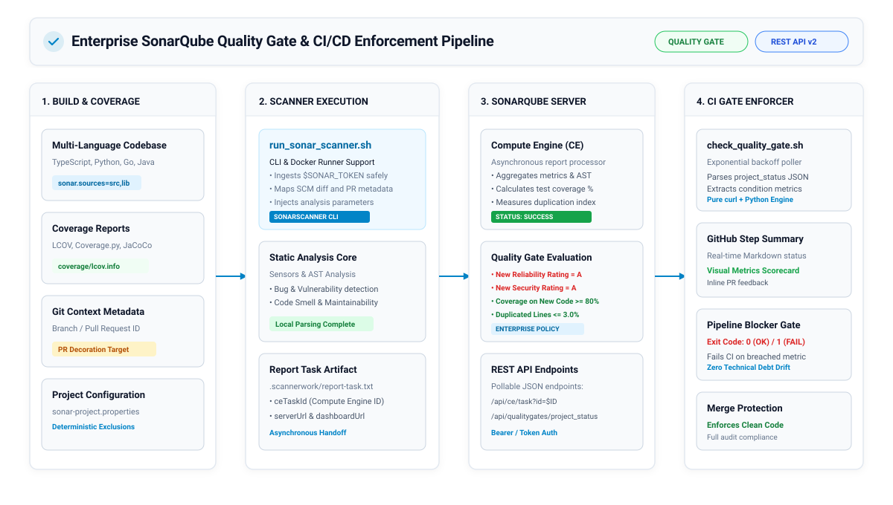

# SonarQube Quality Gate CI/CD Pipeline Integration

[](https://github.com/tayyabmasood911/sonarqube-quality-gate-ci-integration/actions)
[](SECURITY.md)
[](LICENSE)
[](https://docs.sonarsource.com/sonarqube/latest/)
[](#)

An enterprise static code analysis, test coverage verification, and automated Quality Gate enforcement suite. Features automated SonarScanner CLI orchestration, resilient exponential backoff Compute Engine polling, and strict REST API gate evaluations that block pipeline progression upon metric threshold violations.

---

## Architectural Blueprint

The integration orchestrates code metrics, test coverage ingestion, SonarQube Compute Engine processing, and REST API polling into an automated gate.



---

## Key Capabilities

- **Unified Configuration:** `sonar-project.properties` provides multi-language configurations covering JavaScript/TypeScript (LCOV), Python (Coverage.py), Go (`coverage.out`), and Java (JaCoCo).
- **Automated PR & Branch Tracking:** `scripts/run_sonar_scanner.sh` automatically detects GitHub Actions Pull Request metadata and passes `-Dsonar.pullrequest.*` or `-Dsonar.branch.name` parameters.
- **REST API Poller with Backoff:** `scripts/check_quality_gate.sh` parses `.scannerwork/report-task.txt`, polls `/api/ce/task?id=...` until completion, queries `/api/qualitygates/project_status`, and evaluates all metrics.
- **Visual CI Step Summary:** Automatically outputs formatted Markdown tables displaying individual metric outcomes (Coverage, Reliability, Security Rating, Duplications) to GitHub Actions `$GITHUB_STEP_SUMMARY`.
- **Zero-Tolerance Gate Enforcement:** Exits with code 1 when the Quality Gate status is `ERROR` or `WARN`, preventing flawed code from merging.

---

## Quick Start & Usage

### 1. Execute Scan & Evaluate Gate Locally
```bash
# Set credentials
export SONAR_HOST_URL="https://sonarqube.internal.corp"
export SONAR_TOKEN="squ_abcdef1234567890"
export SONAR_PROJECT_KEY="enterprise-cloud-platform"

# Execute Scanner CLI
bash scripts/run_sonar_scanner.sh

# Poll and evaluate Quality Gate
bash scripts/check_quality_gate.sh
```

### 2. GitHub Actions Integration Workflow
```yaml
name: SonarQube Code Quality Gate
on:
  push:
    branches: [main]
  pull_request:
    branches: [main]

jobs:
  sonarqube:
    runs-on: ubuntu-latest
    steps:
      - uses: actions/checkout@v4
        with:
          fetch-depth: 0  # Full Git history required for accurate blame & SCM tracking

      - name: Run Unit Tests & Generate Coverage
        run: |
          npm ci
          npm test -- --coverage

      - name: Execute SonarQube Analysis
        env:
          SONAR_HOST_URL: ${{ secrets.SONAR_HOST_URL }}
          SONAR_TOKEN: ${{ secrets.SONAR_TOKEN }}
          SONAR_PROJECT_KEY: "enterprise-cloud-platform"
        run: bash scripts/run_sonar_scanner.sh

      - name: Enforce SonarQube Quality Gate
        env:
          SONAR_TOKEN: ${{ secrets.SONAR_TOKEN }}
        run: bash scripts/check_quality_gate.sh
```

---

## Configuration Reference: `sonar-project.properties`

| Property | Description | Production Value |
|:---|:---|:---|
| `sonar.projectKey` | Unique identifier for the repository in SonarQube | `enterprise-cloud-platform` |
| `sonar.sources` | Source directories analyzed | `src,lib,cmd,pkg` |
| `sonar.tests` | Test suite directories | `tests,test,spec` |
| `sonar.javascript.lcov.reportPaths` | TypeScript/JavaScript LCOV coverage path | `coverage/lcov.info` |
| `sonar.python.coverage.reportPaths` | Python Coverage.py XML report path | `coverage.xml` |
| `sonar.go.coverage.reportPaths` | Go test coverage profile path | `coverage.out` |
| `sonar.qualitygate.wait` | Forces CLI to wait for analysis completion | `true` |
| `sonar.qualitygate.timeout` | Maximum wait duration in seconds | `300` |

---

## Local Validation & Healthcheck

```bash
# Execute local unit tests
python3 -m unittest discover -s tests -p "test_*.py"

# Run integration healthcheck & mock API validation
bash scripts/healthcheck.sh

# Test SonarQube API client mock mode
python3 scripts/sonar_api_client.py --mock-test
```

---

## Security Governance & Disclosure

For vulnerability disclosures or policy concerns, consult our [Responsible Disclosure Policy](SECURITY.md) or contact **Tayyab Masood** at [tayyabmasood911@gmail.com](mailto:tayyabmasood911@gmail.com).

---

## License

Released under the MIT License. See [LICENSE](LICENSE) for full details.
